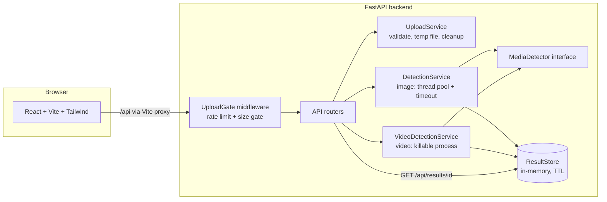
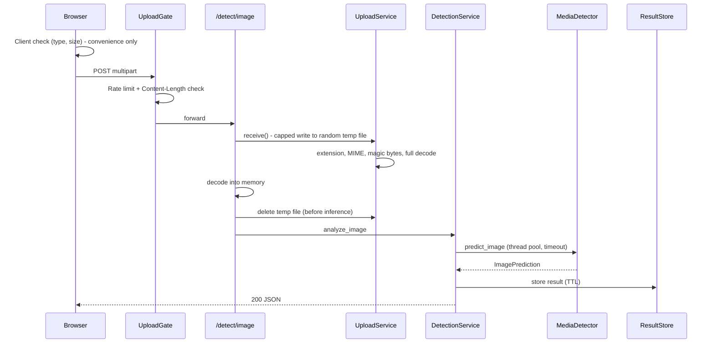

# TruthLens AI — Probabilistic Media Authenticity Analysis

TruthLens AI is a full-stack web application that estimates how likely an uploaded **image or video** is to be AI-generated or manipulated. It reports probabilities and uncertainty, never a verdict, and it always states what kind of detector produced the result.

> **AI detection is probabilistic. Results should not be treated as definitive proof of authenticity or manipulation.**

> **Project status: Phase 6 of 10 complete.** See [Roadmap and phase log](#roadmap-and-phase-log). Sections marked **(planned)** describe features that do not exist yet.

---

## Table of contents

1. [What the project does](#what-the-project-does)
2. [Detector tiers: what a result is worth](#detector-tiers-what-a-result-is-worth)
3. [Why detecting AI-generated media is hard](#why-detecting-ai-generated-media-is-hard)
4. [Architecture](#architecture)
5. [Technology stack](#technology-stack)
6. [Project structure](#project-structure)
7. [Installation and running](#installation-and-running)
8. [Configuration](#configuration)
9. [API documentation](#api-documentation)
10. [Security design](#security-design)
11. [Testing](#testing)
12. [Docker (planned)](#docker-planned)
13. [Dataset preparation and training (planned)](#dataset-preparation-and-training-planned)
14. [Limitations](#limitations)
15. [Ethical considerations](#ethical-considerations)
16. [Troubleshooting](#troubleshooting)
17. [Roadmap and phase log](#roadmap-and-phase-log)

---

## What the project does

| Capability | Status |
|---|---|
| Upload an image (JPEG, PNG, WebP) and get a probability, classification, risk level and typed signals | Working |
| Upload a video (MP4, MOV, AVI, MKV, WebM), sample frames, score each, aggregate, return a frame-level timeline | Working |
| Four outcomes: `LIKELY_REAL`, `UNCERTAIN`, `LIKELY_SYNTHETIC` (plus risk level `LOW`/`MEDIUM`/`HIGH`) | Working |
| Honest labelling of detector quality (tier banner, `score_is_calibrated`, notices) | Working |
| Drag-and-drop uploader, client-side validation, preview, upload progress, cancel, error handling | Working |
| Light/dark theme, responsive layout, accessible components | Working |
| Result dashboard with charts, timeline, metadata, explainability | **Planned (Phase 7)** |
| Grad-CAM heatmaps (only for compatible models) and suspicious-frame view | **Planned (Phase 8)** |
| Training / evaluation pipeline | **Planned (Phase 9)** |
| Docker, full test coverage, ensemble and forensics extras | **Planned (Phase 10)** |

**Important:** the only detector currently included is a **demo heuristic** (see below). It is not a trained AI detector and has no demonstrated accuracy. It exists so the whole application can run end to end until a real model is plugged in.

---

## Detector tiers: what a result is worth

Every API response and every UI page carries the tier of the detector that produced it.

| Tier | Meaning | UI treatment |
|---|---|---|
| `DEMO_HEURISTIC` | Hand-written signal measurements (spectral energy, noise strength) mapped to a score with **placeholder thresholds that were not fitted to any dataset**. | Amber "Prototype mode" banner. Cannot report `HIGH` risk. Score is shrunk into the range 0.2–0.8. |
| `PRETRAINED_ML` | Off-the-shelf third-party classifier, not validated on this project's data. | Notice: generalization unknown. |
| `TRAINED` | Checkpoint produced by this project's `training/` pipeline, shipped with an evaluation report. | Shows the model's measured metrics next to the result. |

Only `DEMO_HEURISTIC` is implemented today. `PRETRAINED_ML` and `TRAINED` arrive with the torch backend (Phases 8–9).

Other honesty rules built into the design:

- **`UNCERTAIN` band.** Scores between `UNCERTAIN_BAND_LOW` and `UNCERTAIN_BAND_HIGH` (default 0.35–0.65) are reported as uncertain instead of forcing a side.
- **`confidence`** is the probability of the leading side. It is **not** a measure of correctness.
- **`score_is_calibrated`** is `false` unless a detector's scores were calibrated on held-out data.
- **Typed explanations.** Each signal has a `source` (`model`, `heuristic`, `forensic`) and a `scored` flag. `scored: false` items are shown for context and do not affect the score. Nothing is described as "facial texture looks synthetic" unless a real model component supports it.
- **No fake heatmaps.** Each detector declares `supports_heatmap`. If `false`, no heatmap is returned or drawn.

---

## Why detecting AI-generated media is hard

- **Generators keep changing.** A detector trained on today's generators often fails on tomorrow's.
- **Post-processing destroys evidence.** Resizing, cropping, JPEG re-compression and social-media re-encoding remove the fine-grained traces many detectors depend on, and add artifacts to real media.
- **Real photos look "synthetic" too.** Denoising, beauty filters, screenshots and heavy compression can mimic the statistics of generated images.
- **Different problems.** Fully AI-generated images and face-swap deepfakes leave different traces. One binary classifier usually handles one better than the other. This project's binary `real`/`fake` labelling cannot distinguish them.
- **Adversarial evasion.** A determined person can modify content specifically to fool a detector.
- **Metadata is weak evidence.** EXIF data can be stripped from real photos and forged onto synthetic ones. The app shows metadata for context and says so.

See [Limitations](#limitations) for the full list.

---

## Architecture

### System overview



### Image request flow



### Video request flow

```mermaid
flowchart LR
    A[Temp video file] --> B[Worker process<br/>spawned, killed on timeout]
    B --> C[Metadata + limits<br/>fps, duration, size]
    C --> D[Pass 1: decode all,<br/>count real frames,<br/>find scene cuts]
    D --> E[Pick frames<br/>75% uniform + up to 25% scene cuts]
    E --> F[Pass 2: extract chosen frames]
    F --> G[Image detector per frame]
    G --> H[Aggregate:<br/>0.7 x trimmed mean + 0.3 x top-quarter mean]
    H --> I[Video result + frame timeline]
```



Key design choices:

- **Modular ML layer.** The API only knows the `MediaDetector` interface (`app/ml/detector.py`). A real model is a new subclass registered in `app/ml/model_loader.py`; nothing else changes.
- **Video runs in a separate process** that is killed if `VIDEO_TIMEOUT_SEC` expires, because `cv2.VideoCapture` has no timeout and threads cannot be stopped. Cost: roughly 1–3 s of process start-up per video.
- **Aggregation is a documented design choice, not fitted to data.** A plain mean hides a short manipulated segment; a max is dominated by noise. The response returns every statistic and the rule text.
- **Temp files are deleted before image inference** (matters on Windows, where a file held open cannot be deleted).
- **Nothing is stored permanently.** Uploaded media is deleted after analysis. Results (scores and metadata only) live in memory for `RESULT_TTL_SECONDS`.

---

## Technology stack

| Layer | Technology |
|---|---|
| Frontend | JavaScript, React 18, Vite 7, Tailwind CSS v4, React Router 6, Axios, lucide-react, Vitest |
| Backend | Python 3.10+, FastAPI, Uvicorn, Pydantic v2 + pydantic-settings, Pillow, OpenCV (headless), NumPy |
| Testing | pytest, httpx (backend); Vitest (frontend) |
| Planned | Recharts (Phase 7), PyTorch + torchvision (Phases 8–9), Docker + nginx (Phase 10) |

---

## Project structure

Files that exist today (after Phase 6):

```
truthlens-ai/
├── .env.example
├── .gitignore
├── pytest.ini
├── README.md
├── backend/
│   ├── requirements.txt
│   ├── requirements-dev.txt
│   └── app/
│       ├── __main__.py            run with: python -m app
│       ├── main.py                app factory, middleware stack, lifespan
│       ├── config.py              environment-based settings
│       ├── dependencies.py
│       ├── middleware.py          request IDs, upload gate (rate limit + size)
│       ├── api/                   health, models, detect_image, detect_video, results
│       ├── schemas/               Pydantic models (common, errors, image, video, ...)
│       ├── services/              upload, detection, video, process_runner, rate_limiter, result_store
│       ├── ml/
│       │   ├── detector.py        MediaDetector interface + dataclasses
│       │   ├── image_detector.py  DEMO heuristic detector
│       │   ├── video_detector.py  frame-wise analysis + aggregation
│       │   ├── video_sampling.py  two-pass frame sampler
│       │   ├── preprocessing.py
│       │   ├── model_loader.py    detector registry (plug-in point)
│       │   └── forensics/image_features.py
│       └── utils/                 errors, logging, media_types, scoring
├── frontend/
│   ├── index.html, package.json, vite.config.js
│   └── src/
│       ├── components/            Navbar, ThemeToggle, UploadZone, MediaPreview,
│       │                          DetectorTierBanner, DisclaimerNotice, ErrorMessage,
│       │                          LoadingState, SkeletonCard
│       ├── pages/                 Home, Results (basic), About, NotFound
│       ├── hooks/                 useTheme, useServerInfo, useDetection, useResult
│       ├── services/api.js
│       ├── utils/                 formatting, validation
│       └── __tests__/
└── tests/backend/                 pytest suite
```

Planned additions: `training/` (Phase 9), `docker-compose*.yml` and Dockerfiles (Phase 10), `backend/app/ml/explainability.py` and `ensemble.py` (Phases 8 and 10), `docs/architecture.md`.

---

## Installation and running

### Prerequisites

- **Python 3.10 or newer**
- **Node.js 20.19+ or 22.12+** (required by Vite 7)
- Git

### 1. Clone and configure

```bash
cp .env.example .env          # Windows: copy .env.example .env
```

The `.env` file lives at the **repository root** and is read by both the backend and the frontend.

### 2. Backend

```bash
python -m venv .venv
source .venv/bin/activate     # Windows (PowerShell): .venv\Scripts\Activate.ps1
pip install -r backend/requirements.txt -r backend/requirements-dev.txt

cd backend
python -m app                 # serves http://127.0.0.1:8000
```

- Interactive API docs (Swagger): http://127.0.0.1:8000/docs
- Quick check: `curl http://127.0.0.1:8000/api/health`
  (PowerShell: use `curl.exe` or `Invoke-RestMethod`, because `curl` is an alias for `Invoke-WebRequest`)

### 3. Frontend

```bash
cd frontend
npm install
npm run dev                   # serves http://localhost:5173
```

In development, Vite proxies `/api` to `http://127.0.0.1:8000`, so no CORS setup is needed. Open **http://localhost:5173**.

### 4. Try it

1. Open the site. An amber **Prototype mode** banner confirms the demo detector is active.
2. Drop in an image or short video and click **Analyze Media**.
3. You are taken to `/results/<id>`. The dashboard is still basic (Phase 7 builds the full one) but shows the classification, probabilities, notices and the raw JSON.

---

## Configuration

All settings are environment variables (see `.env.example`). Invalid values stop the server at start-up with a message naming the field.

| Variable | Default | Purpose |
|---|---|---|
| `ENVIRONMENT` | `development` | `development`, `production` or `test`. Development enables auto-reload. |
| `LOG_LEVEL` | `INFO` | `DEBUG`, `INFO`, `WARNING`, `ERROR` |
| `BACKEND_HOST` / `BACKEND_PORT` | `127.0.0.1` / `8000` | Use `0.0.0.0` inside Docker. |
| `CORS_ORIGINS` | `http://localhost:5173,http://127.0.0.1:5173` | Comma-separated, no trailing slash. Never `*` by default. |
| `RATE_LIMIT_PER_MINUTE` | `30` | Per client IP on `POST /api/detect/*`. `0` disables. |
| `TRUST_PROXY_HEADERS` | `false` | Set `true` only behind a reverse proxy you control. |
| `MAX_IMAGE_SIZE_MB` / `MAX_VIDEO_SIZE_MB` | `10` / `100` | Per-file limits. |
| `MAX_IMAGE_PIXELS` | `40000000` | Decompression-bomb guard. |
| `MAX_VIDEO_PIXELS` | `8294400` | 3840×2160. |
| `MAX_VIDEO_DURATION_SEC` | `60` | Enforced on the real decoded frame count, not just metadata. |
| `MAX_VIDEO_FRAMES_ANALYZED` | `24` | Frame budget per video. |
| `TEMP_DIR` | `<system temp>/truthlens-uploads` | Randomly named temp files, always deleted. |
| `DETECTOR_BACKEND` | `demo` | `demo` today. `torch`/`ensemble` are reserved for later phases; selecting them now puts the server in degraded mode. |
| `MODEL_PATH`, `MODEL_META_PATH` | empty | For trained models (later phases). |
| `DEVICE` | `auto` | `auto`, `cpu`, `cuda`. |
| `UNCERTAIN_BAND_LOW` / `_HIGH` | `0.35` / `0.65` | Scores inside the band are `UNCERTAIN`. |
| `REQUEST_TIMEOUT_SEC` | `30` | Max wait for one image analysis. |
| `MAX_CONCURRENT_ANALYSES` | `2` | Image inference worker threads. |
| `RESULT_TTL_SECONDS` | `900` | How long `GET /api/results/{id}` works. |
| `RESULT_STORE_MAX_ENTRIES` | `200` | Oldest results are evicted beyond this. |
| `VIDEO_TIMEOUT_SEC` | `120` | Hard limit: the worker process is killed after this. |
| `MAX_CONCURRENT_VIDEO_ANALYSES` | `1` | Extra requests get `503 SERVER_BUSY`. |
| `VITE_API_BASE_URL` | unset (`/api`) | Frontend only. Set a full URL only if the frontend is served separately. |

---

## API documentation

Base path: `/api`. Interactive docs at `/docs`.

| Endpoint | Purpose | Success | Notable errors |
|---|---|---|---|
| `GET /api/health` | Liveness and detector status | `200` | `503` if the detector failed to load (body still describes the state) |
| `GET /api/models` | Active detector, tier, capabilities, uncertain band, limits | `200` | |
| `POST /api/detect/image` | Analyze an image (multipart field `file`) | `200` | `400, 411, 413, 415, 422, 429, 500, 503, 504` |
| `POST /api/detect/video` | Analyze a video (multipart field `file`) | `200` | same, plus `503 SERVER_BUSY` |
| `GET /api/results/{id}` | Fetch a recent result (image or video) | `200` | `404` unknown or expired |

### Image response (abbreviated)

```json
{
  "id": "3f9c0a7e5b2d4c1e8a6f1b9d0c2e4a77",
  "media_type": "image",
  "classification": "UNCERTAIN",
  "classification_label": "Uncertain",
  "confidence": 0.5812,
  "real_probability": 0.5812,
  "ai_probability": 0.4188,
  "risk_level": "MEDIUM",
  "processing_time_ms": 94,
  "model": "demo-heuristic",
  "detector_version": "0.1.0",
  "detector_tier": "DEMO_HEURISTIC",
  "tier_notice": "Prototype mode: ...",
  "score_is_calibrated": false,
  "uncertain_band": [0.35, 0.65],
  "explanation": [
    {"key": "high_frequency_energy", "scored": true, "source": "heuristic",
     "value": -2.31, "unit": "log10 ratio", "direction": "toward_synthetic", "detail": "..."},
    {"key": "exif_presence", "scored": false, "source": "forensic", "detail": "..."}
  ],
  "explanation_notice": "These items are measured image statistics. ...",
  "metadata": {"width": 1920, "height": 1080, "megapixels": 2.07, "format": "jpeg",
               "color_mode": "RGB", "has_alpha": false, "has_exif": true, "size_bytes": 412345},
  "created_at": "2026-10-12T10:15:30.123456Z",
  "disclaimer": "AI detection is probabilistic. ..."
}
```

Classification values are `LIKELY_REAL`, `UNCERTAIN`, `LIKELY_SYNTHETIC`. "Synthetic" covers AI-generated **or** manipulated media, because a binary detector cannot tell them apart.

### Video response (additional fields)

```json
{
  "media_type": "video",
  "frames_analyzed": 24,
  "frame_results": [
    {"frame_number": 12, "timestamp_sec": 0.4, "ai_probability": 0.4312,
     "selection": "uniform", "flagged": false}
  ],
  "highest_scoring_frames": ["... top 5 by score ..."],
  "sampling": {"frames_decoded": 900, "uniform_frames": 21, "scene_change_frames": 3,
               "coverage_fraction": 0.0267, "...": "..."},
  "aggregation": {"method": "0.70 x trimmed mean + 0.30 x mean of top 25% of frames",
                  "trimmed_mean": 0.43, "top_quarter_mean": 0.47, "std_dev": 0.02, "...": "..."},
  "warnings": ["Frames are scored independently. Frame-to-frame (temporal) artifacts, audio and lip-sync are not examined.", "..."],
  "metadata": {"width": 1920, "height": 1080, "fps": 30.0, "duration_sec": 30.0,
               "frame_count_reported": 900, "frames_decoded": 900, "codec": "avc1", "size_bytes": 8421337}
}
```

### Error format

All errors use one shape. Stack traces are never returned; they are logged server-side against the `request_id` (also sent as the `X-Request-ID` header).

```json
{"error": {"code": "UNSUPPORTED_MEDIA_TYPE", "message": "File content does not match a supported image format.", "request_id": "9f1c..."}}
```

| HTTP | Code | When |
|---|---|---|
| 400 | `CORRUPTED_MEDIA` | Empty, truncated or undecodable file |
| 411 | `LENGTH_REQUIRED` | Upload without `Content-Length` |
| 413 | `FILE_TOO_LARGE` | Over the per-file or request size limit |
| 415 | `UNSUPPORTED_MEDIA_TYPE` | Bad extension, declared MIME, or content that does not match |
| 422 | `VALIDATION_ERROR` | Missing or invalid form field |
| 422 | `MEDIA_LIMIT_EXCEEDED` family | `IMAGE_TOO_SMALL`, `IMAGE_DIMENSIONS_TOO_LARGE`, `VIDEO_TOO_LONG`, `VIDEO_RESOLUTION_TOO_HIGH` |
| 429 | `RATE_LIMITED` | Includes a `Retry-After` header |
| 404 | `RESULT_NOT_FOUND`, `NOT_FOUND` | Unknown or expired result, unknown route |
| 500 | `MODEL_ERROR`, `INTERNAL_ERROR` | Detector failure or unexpected error |
| 503 | `DETECTOR_UNAVAILABLE`, `SERVER_BUSY` | Model not loaded; too many concurrent videos (`Retry-After`) |
| 504 | `INFERENCE_TIMEOUT` | Analysis exceeded its time limit |

---

## Security design

- **Layered upload validation:** extension allowlist, declared MIME, capped write to a randomly named file, magic-byte sniffing, full decode (Pillow / OpenCV), then dimension and duration limits.
- **Size limits enforced twice:** an ASGI gate rejects oversized or length-less requests **before the body is parsed** (multipart parsing buffers to disk first), and a per-file streaming cap is the second layer.
- **Client filenames are never trusted.** Only an allowlisted extension is read; the temp name is `uuid4` + extension, created with exclusive-create mode.
- **Cleanup in `finally`**, plus a start-up sweep that only deletes files matching the temp-name pattern.
- **Decompression-bomb protection:** Pillow pixel cap, plus video resolution, duration and decoded-frame limits.
- **Killable video worker:** a hung or crashing decoder cannot take down the server.
- **Rate limiting** per client IP (in-memory sliding window behind an interface; swap for Redis if you run multiple workers).
- **CORS** from an explicit allowlist; no credentials.
- **No shell or subprocess calls** from user input; errors never echo client input or stack traces.
- **Uploads are not stored permanently.**

Client-side validation in the browser is a convenience only; the server repeats every check.

---

## Testing

### Backend (pytest)

Run from the **repository root**, not from `backend/`. On Windows use `python -m pytest` (the video worker tests spawn child processes that cannot re-import a console-script launcher).

```bash
python -m pytest -v
```

Covers: health and models endpoints, CORS, request IDs, image upload (valid, empty, wrong extension, wrong MIME, renamed text file, truncated, oversized, path traversal, too small), rate limiting, response schema, detector behaviour and feature functions, preprocessing, scoring and risk rules, result store TTL/eviction, video sampling and aggregation, the killable process runner (timeout, crash, error propagation), and the video endpoint (valid, corrupted, too long, timeout, detector unavailable). Video tests take longer because they start real worker processes (roughly 20–60 s total).

### Frontend (Vitest)

```bash
cd frontend
npm test
```

Covers file validation, formatting, API error mapping and retry rules, and the detection state-machine reducer. Component tests with React Testing Library are planned for Phase 10.

---

## Docker (planned)

Planned for Phase 10: `docker compose up --build` using a CPU-only backend image by default, nginx serving the built frontend and proxying `/api`, and an optional `docker-compose.gpu.yml` override for CUDA. `DEVICE=auto` will fall back to CPU. **Not implemented yet.**

---

## Dataset preparation and training (planned)

Planned for Phase 9 (`training/`): group-aware dataset splitting, augmentation, class balancing, checkpoint saving, evaluation (accuracy, precision, recall, F1, ROC-AUC, confusion matrix, calibration check, robustness to JPEG compression and resizing), and an export step that writes the weights plus a metadata file the backend reads. **Not implemented yet.**

The design rules that will apply:

- **Folder layout:** `dataset/{train,validation,test}/{real,fake}/`. An optional three-class mode (`real`, `ai_generated`, `manipulated`) is planned.
- **Dataset leakage:** near-duplicates in different splits inflate test scores. Splits must be made by **group ID** (original video, source image, identity, generator/prompt batch), never by individual file. For video, all frames from one video must stay in one split.
- **Do not bundle copyrighted datasets.** The project will document where public datasets can be obtained and how to place them in the expected structure.
- **Do not rely on accuracy alone.**

---

## Limitations

The following apply to **any** detector, and especially to the demo heuristic:

- **False positives:** real images flagged as synthetic (denoising, filters, screenshots, compression).
- **False negatives:** synthetic media passing as real.
- **Dataset bias:** a detector inherits its training data's biases.
- **Generalization:** test-set performance rarely transfers fully to new generators.
- **New generative models** can invalidate a detector.
- **Compression and resizing** erase traces; **social-media recompression** can destroy evidence and add artifacts.
- **Adversarial manipulation** can evade detection.
- **Uncertainty:** unless a model is calibrated, a score of 0.8 does not mean "80% likely".

Specific to the current build:

- The demo detector measures two statistics with placeholder thresholds. Expect many wrong answers in both directions.
- **Video frames are scored independently.** Temporal artifacts, audio and lip-sync are not examined, and a brief manipulated segment between sampled frames can be missed.
- Scene-cut detection uses a fixed threshold and finds hard cuts, not fades.
- Some `.webm`/`.mkv` files report no frame count and are rejected as corrupted; re-encode to MP4. A fallback is planned for Phase 10.
- **Cancel** in the UI stops waiting but cannot stop work already running on the server.
- Analysis progress is indeterminate (the backend has no job/polling API); only the upload shows real progress.
- Results are in server memory: they expire after `RESULT_TTL_SECONDS` and are lost on restart.
- The rate limiter is per process.

---

## Ethical considerations

- A "likely synthetic" or "likely real" output must **never** be the sole basis for accusing a person, rejecting a claim, or making any decision with consequences.
- Detectors can be wrong in ways that fall unevenly across skin tones, cameras, ages and image styles. Evaluate any trained model for such disparities before use.
- Detection tools can be used to dismiss genuine evidence ("it's probably AI"). Communicate uncertainty plainly.
- Uploads may contain personal data. Files are deleted after analysis, EXIF contents (such as GPS) are never read out or returned (only the presence of EXIF is reported), and results contain scores and technical metadata only. If you deploy this publicly, add a privacy notice and review applicable law.
- This is a student/portfolio project, not a forensic tool.

---

## Troubleshooting

| Symptom | Cause / fix |
|---|---|
| `ImportError: cannot import name 'StrEnum'` | Old file. The project targets Python 3.10+; use `(str, Enum)` as in the current `schemas/common.py`. |
| `ModuleNotFoundError: No module named 'app'` | Run the server from `backend/` and `pytest` from the repo root. |
| Video worker tests fail mentioning `pytest.exe` | Use `python -m pytest` on Windows. |
| `/api/health` returns 503 | `DETECTOR_BACKEND` is not `demo`, or the detector failed to load (see server logs). |
| Browser shows a CORS error | Add your frontend origin to `CORS_ORIGINS` (no trailing slash), restart. In dev, leave `VITE_API_BASE_URL` unset and use the Vite proxy. |
| Red "Server unreachable" banner | Backend not running, or the port differs from the one in `vite.config.js`. |
| `Port 5173 is already in use` | Deliberate (`strictPort`); close the other dev server. |
| `429` while testing | Raise `RATE_LIMIT_PER_MINUTE`, or set it to `0`. |
| `504 INFERENCE_TIMEOUT` on a video | Raise `VIDEO_TIMEOUT_SEC`. |
| `503 SERVER_BUSY` | Raise `MAX_CONCURRENT_VIDEO_ANALYSES` (each job uses its own process and RAM). |
| Results page says "not found or expired" | Results live only in memory for `RESULT_TTL_SECONDS` and vanish on restart. |
| AVI/MKV shows "browser cannot preview" | Expected: browsers cannot decode those containers. The file can still be analyzed. |

---

## Roadmap and phase log

| Phase | Deliverable | Status |
|---|---|---|
| 1 | Architecture, stack, data flow, roadmap | Done |
| 2 | FastAPI skeleton: config, health, models, secure upload validation, uniform errors, rate limiting | Done |
| 3 | Preprocessing, `MediaDetector` interface, demo detector, image detection API, result store | Done |
| 4 | Video metadata, frame sampling, aggregation, killable worker process, video detection API | Done |
| 5 | React + Vite + Tailwind shell, theme, uploader, client-side validation, preview | Done |
| 6 | Axios service, `useDetection`, loading/error states, results route (basic) | Done |
| 7 | Results dashboard: badge, meters, charts, video timeline, metadata, signals | Next |
| 8 | Explainability: Grad-CAM for compatible models, suspicious frames, capability gating | Planned |
| 9 | Training pipeline: group-aware split, train, evaluate, export | Planned |
| 10 | Tests, Docker, ensemble/forensics extras, `.webm`/`.mkv` frame-count fallback, final polish | Planned |

### Phase log

- **Phase 6:** Added real uploads with progress and cancel, stale-response protection, `Retry-After` handling, retry only for retryable errors, result loading via `GET /api/results/{id}` after refresh, loading skeletons. Fixed the About link to use the router.
- **Phase 5:** Added the frontend shell, theme, uploader with client-side validation, preview, tier banner and disclaimer, About page.
- **Phase 4:** Added video analysis in a killable process, two-pass sampling (uniform plus scene cuts), documented aggregation, video response schema.
- **Phase 3:** Added the `MediaDetector` interface, demo heuristic detector, scoring/risk rules, typed signals, result store and `GET /api/results/{id}`. Demo tier can never report `HIGH` risk.
- **Phase 2:** Added the backend skeleton, secure upload service, ASGI upload gate, rate limiter, uniform error handling.
- **Phase 1:** Architecture and plan.

*This README is updated at the end of every phase.*