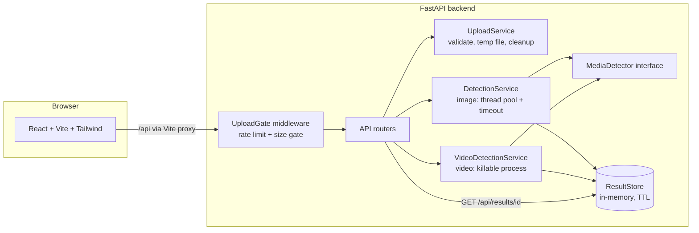
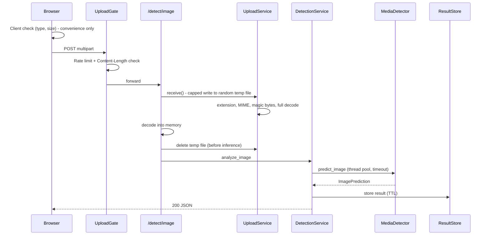
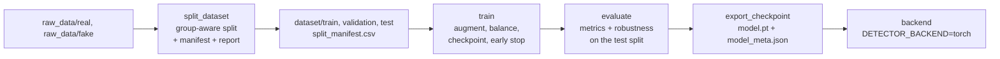

# TruthLens AI — Probabilistic Media Authenticity Analysis

TruthLens AI is a full-stack web application that estimates how likely an uploaded **image or video** is to be AI-generated or manipulated. It reports probabilities and uncertainty, never a verdict, and it always states what kind of detector produced the result.

> **AI detection is probabilistic. Results should not be treated as definitive proof of authenticity or manipulation.**

> **Project status: Phase 9 of 10 complete.** See [Roadmap and phase log](#roadmap-and-phase-log). Sections marked **(planned)** describe features that do not exist yet.

---

## Table of contents

1. [What the project does](#what-the-project-does)
2. [Detector tiers: what a result is worth](#detector-tiers-what-a-result-is-worth)
3. [Why detecting AI-generated media is hard](#why-detecting-ai-generated-media-is-hard)
4. [Architecture](#architecture)
5. [Technology stack](#technology-stack)
6. [Project structure](#project-structure)
7. [Installation and running](#installation-and-running)
8. [Configuration](#configuration)
   - [Using a real model (torch backend)](#using-a-real-model-torch-backend)
9. [API documentation](#api-documentation)
10. [Security design](#security-design)
11. [Testing](#testing)
12. [Docker (planned)](#docker-planned)
13. [Dataset preparation and training](#dataset-preparation-and-training)
14. [Limitations](#limitations)
15. [Ethical considerations](#ethical-considerations)
16. [Troubleshooting](#troubleshooting)
17. [Roadmap and phase log](#roadmap-and-phase-log)

---

## What the project does

| Capability | Status |
|---|---|
| Upload an image (JPEG, PNG, WebP) and get a probability, classification, risk level and typed signals | Working |
| Upload a video (MP4, MOV, AVI, MKV, WebM), sample frames, score each, aggregate, return a frame-level timeline | Working |
| Four outcomes: `LIKELY_REAL`, `UNCERTAIN`, `LIKELY_SYNTHETIC` (plus risk level `LOW`/`MEDIUM`/`HIGH`) | Working |
| Honest labelling of detector quality (tier banner, `score_is_calibrated`, notices) | Working |
| Drag-and-drop uploader, client-side validation, preview, upload progress, cancel, error handling | Working |
| Light/dark theme, responsive layout, accessible components | Working |
| Result dashboard: classification badge, confidence meter, real-vs-AI bars, score zones, risk level, technical metadata | Working |
| Video timeline chart (Recharts) with the uncertain band, highest-scoring frames, click-to-seek in the original video, table alternative | Working |
| "Why did the model predict this?" panel: scored signals separated from context-only items, source labels | Working |
| PyTorch detector backend: loads a pretrained (Hugging Face) or trained (torchvision) model described by a `model_meta.json` (optional install, no weights shipped) | Working |
| Grad-CAM heatmap overlay with opacity control, only for models whose layer supports it (capability-gated, never faked) | Working |
| Training pipeline: group-aware dataset splitting, augmentation, class balancing, checkpoints, evaluation (accuracy, precision, recall, F1, ROC-AUC, confusion matrix, calibration error, robustness to compression/resizing/blur), export to a loadable `TRAINED` model | Working |
| "Measured performance of this model" panel on the results page (for models that carry an `evaluation`) | Working |
| Docker, full test coverage, ensemble and forensics extras | **Planned (Phase 10)** |

**Important:** the only detector currently included is a **demo heuristic** (see below). It is not a trained AI detector and has no demonstrated accuracy. It exists so the whole application can run end to end until a real model is plugged in.

---

## Detector tiers: what a result is worth

Every API response and every UI page carries the tier of the detector that produced it.

| Tier | Meaning | UI treatment |
|---|---|---|
| `DEMO_HEURISTIC` | Hand-written signal measurements (spectral energy, noise strength) mapped to a score with **placeholder thresholds that were not fitted to any dataset**. | Amber "Prototype mode" banner. Cannot report `HIGH` risk. Score is shrunk into the range 0.2–0.8. |
| `PRETRAINED_ML` | Off-the-shelf third-party classifier, not validated on this project's data. | Notice: generalization unknown. |
| `TRAINED` | Checkpoint produced by this project's `training/` pipeline, shipped with an evaluation report. | Shows the model's measured metrics next to the result. |

`DEMO_HEURISTIC` is the default. `PRETRAINED_ML` and `TRAINED` are available through the optional torch backend (see [Using a real model](#using-a-real-model-torch-backend)), but **the repository ships no model weights**: you supply them. A `TRAINED` model must carry an `evaluation` section in its metadata or it will not load; the [training pipeline](#dataset-preparation-and-training) produces one.

Other honesty rules built into the design:

- **`UNCERTAIN` band.** Scores between `UNCERTAIN_BAND_LOW` and `UNCERTAIN_BAND_HIGH` (default 0.35–0.65) are reported as uncertain instead of forcing a side.
- **`confidence`** is the probability of the leading side. It is **not** a measure of correctness.
- **`score_is_calibrated`** is `false` unless a detector's scores were calibrated on held-out data.
- **Typed explanations.** Each signal has a `source` (`model`, `heuristic`, `forensic`) and a `scored` flag. `scored: false` items are shown for context and do not affect the score. Nothing is described as "facial texture looks synthetic" unless a real model component supports it.
- **No fake heatmaps.** Each detector declares `supports_heatmap`. If `false`, no heatmap is returned or drawn.

---

## Why detecting AI-generated media is hard

- **Generators keep changing.** A detector trained on today's generators often fails on tomorrow's.
- **Post-processing destroys evidence.** Resizing, cropping, JPEG re-compression and social-media re-encoding remove the fine-grained traces many detectors depend on, and add artifacts to real media.
- **Real photos look "synthetic" too.** Denoising, beauty filters, screenshots and heavy compression can mimic the statistics of generated images.
- **Different problems.** Fully AI-generated images and face-swap deepfakes leave different traces. One binary classifier usually handles one better than the other. This project's binary `real`/`fake` labelling cannot distinguish them.
- **Adversarial evasion.** A determined person can modify content specifically to fool a detector.
- **Metadata is weak evidence.** EXIF data can be stripped from real photos and forged onto synthetic ones. The app shows metadata for context and says so.

See [Limitations](#limitations) for the full list.

---

## Architecture

### System overview



### Image request flow



### Video request flow

```mermaid
flowchart LR
    A[Temp video file] --> B[Worker process<br/>spawned, killed on timeout]
    B --> C[Metadata + limits<br/>fps, duration, size]
    C --> D[Pass 1: decode all,<br/>count real frames,<br/>find scene cuts]
    D --> E[Pick frames<br/>75% uniform + up to 25% scene cuts]
    E --> F[Pass 2: extract chosen frames]
    F --> G[Image detector per frame]
    G --> H[Aggregate:<br/>0.7 x trimmed mean + 0.3 x top-quarter mean]
    H --> I[Video result + frame timeline]
```



Key design choices:

- **Modular ML layer.** The API only knows the `MediaDetector` interface (`app/ml/detector.py`). A real model is a new subclass registered in `app/ml/model_loader.py`; nothing else changes.
- **Video runs in a separate process** that is killed if `VIDEO_TIMEOUT_SEC` expires, because `cv2.VideoCapture` has no timeout and threads cannot be stopped. Cost: roughly 1–3 s of process start-up per video.
- **Aggregation is a documented design choice, not fitted to data.** A plain mean hides a short manipulated segment; a max is dominated by noise. The response returns every statistic and the rule text.
- **Temp files are deleted before image inference** (matters on Windows, where a file held open cannot be deleted).
- **Nothing is stored permanently.** Uploaded media is deleted after analysis. Results (scores and metadata only) live in memory for `RESULT_TTL_SECONDS`.

---

## Technology stack

| Layer | Technology |
|---|---|
| Frontend | JavaScript, React 18, Vite 7, Tailwind CSS v4, React Router 6, Axios, lucide-react, Vitest |
| Backend | Python 3.10+, FastAPI, Uvicorn, Pydantic v2 + pydantic-settings, Pillow, OpenCV (headless), NumPy |
| Testing | pytest, httpx (backend); Vitest (frontend) |
| Charts | Recharts |
| ML (optional) | PyTorch, torchvision, transformers, safetensors (`backend/requirements-torch.txt`); matplotlib for optional plots (`backend/requirements-train.txt`) |
| Planned | Docker + nginx (Phase 10) |

---

## Project structure

Files that exist today (after Phase 9):

```
truthlens-ai/
├── .env.example
├── .gitignore
├── pytest.ini
├── README.md
├── backend/
│   ├── requirements.txt
│   ├── requirements-dev.txt
│   ├── requirements-torch.txt     optional: PyTorch, torchvision, transformers
│   ├── scripts/fetch_hf_model.py  download a Hugging Face model + write model_meta.json
│   ├── scripts/make_dummy_model.py  RANDOM weights, only for testing the heatmap UI
│   ├── requirements-train.txt     optional: adds matplotlib for training plots
│   └── app/
│       ├── __main__.py            run with: python -m app
│       ├── main.py                app factory, middleware stack, lifespan
│       ├── config.py              environment-based settings
│       ├── dependencies.py
│       ├── middleware.py          request IDs, upload gate (rate limit + size)
│       ├── api/                   health, models, detect_image, detect_video, results
│       ├── schemas/               Pydantic models (common, errors, image, video, ...)
│       ├── services/              upload, detection, video, process_runner, rate_limiter, result_store
│       ├── ml/
│       │   ├── detector.py        MediaDetector interface + dataclasses
│       │   ├── image_detector.py  DEMO heuristic detector
│       │   ├── video_detector.py  frame-wise analysis + aggregation
│       │   ├── video_sampling.py  two-pass frame sampler
│       │   ├── preprocessing.py
│       │   ├── model_loader.py    detector registry (plug-in point)
│       │   ├── model_meta.py      model_meta.json schema and validation
│       │   ├── torch_detector.py  PyTorch detector (optional install)
│       │   ├── explainability.py  Grad-CAM and heatmap rendering
│       │   └── forensics/image_features.py
│       └── utils/                 errors, logging, media_types, scoring
├── frontend/
│   ├── index.html, package.json, vite.config.js
│   └── src/
│       ├── components/            Navbar, ThemeToggle, UploadZone, MediaPreview,
│       │                          DetectorTierBanner, DisclaimerNotice, ErrorMessage,
│       │                          LoadingState, SkeletonCard, ClassificationBadge, RiskBadge,
│       │                          ConfidenceMeter, ProbabilityChart, VideoTimeline,
│       │                          SuspiciousFrames, AggregationPanel, MetadataPanel,
│       │                          ExplainabilityPanel, HeatmapOverlay, DetectionResult
│       ├── pages/                 Home, Results (dashboard), About, NotFound
│       ├── hooks/                 useTheme, useServerInfo, useDetection, useResult
│       ├── services/api.js
│       ├── utils/                 formatting, validation, resultPresentation, mediaStore, heatmap
│       └── __tests__/
├── training/                      split, train, evaluate, export (see the training section)
└── tests/backend/                 pytest suite
```

Planned additions: `docker-compose*.yml` and Dockerfiles (Phase 10), `backend/app/ml/ensemble.py` (Phase 10), `docs/architecture.md`.

---

## Installation and running

### Prerequisites

- **Python 3.10 or newer**
- **Node.js 20.19+ or 22.12+** (required by Vite 7)
- Git

### 1. Clone and configure

```bash
cp .env.example .env          # Windows: copy .env.example .env
```

The `.env` file lives at the **repository root** and is read by both the backend and the frontend.

### 2. Backend

```bash
python -m venv .venv
source .venv/bin/activate     # Windows (PowerShell): .venv\Scripts\Activate.ps1
pip install -r backend/requirements.txt -r backend/requirements-dev.txt

cd backend
python -m app                 # serves http://127.0.0.1:8000
```

- Interactive API docs (Swagger): http://127.0.0.1:8000/docs
- Quick check: `curl http://127.0.0.1:8000/api/health`
  (PowerShell: use `curl.exe` or `Invoke-RestMethod`, because `curl` is an alias for `Invoke-WebRequest`)

### 3. Frontend

```bash
cd frontend
npm install
npm run dev                   # serves http://localhost:5173
```

In development, Vite proxies `/api` to `http://127.0.0.1:8000`, so no CORS setup is needed. Open **http://localhost:5173**.

### 4. Try it

1. Open the site. An amber **Prototype mode** banner confirms the demo detector is active.
2. Drop in an image or short video and click **Analyze Media**.
3. You are taken to `/results/<id>`. The dashboard shows the classification badge, confidence meter, real-vs-AI probability bars, risk level, metadata and the signals behind the score. For videos it adds the frame timeline and the highest-scoring frames (click one to jump to that moment in your original video).

---

## Configuration

All settings are environment variables (see `.env.example`). Invalid values stop the server at start-up with a message naming the field.

| Variable | Default | Purpose |
|---|---|---|
| `ENVIRONMENT` | `development` | `development`, `production` or `test`. Development enables auto-reload. |
| `LOG_LEVEL` | `INFO` | `DEBUG`, `INFO`, `WARNING`, `ERROR` |
| `BACKEND_HOST` / `BACKEND_PORT` | `127.0.0.1` / `8000` | Use `0.0.0.0` inside Docker. |
| `CORS_ORIGINS` | `http://localhost:5173,http://127.0.0.1:5173` | Comma-separated, no trailing slash. Never `*` by default. |
| `RATE_LIMIT_PER_MINUTE` | `30` | Per client IP on `POST /api/detect/*`. `0` disables. |
| `TRUST_PROXY_HEADERS` | `false` | Set `true` only behind a reverse proxy you control. |
| `MAX_IMAGE_SIZE_MB` / `MAX_VIDEO_SIZE_MB` | `10` / `100` | Per-file limits. |
| `MAX_IMAGE_PIXELS` | `40000000` | Decompression-bomb guard. |
| `MAX_VIDEO_PIXELS` | `8294400` | 3840×2160. |
| `MAX_VIDEO_DURATION_SEC` | `60` | Enforced on the real decoded frame count, not just metadata. |
| `MAX_VIDEO_FRAMES_ANALYZED` | `24` | Frame budget per video. |
| `TEMP_DIR` | `<system temp>/truthlens-uploads` | Randomly named temp files, always deleted. |
| `DETECTOR_BACKEND` | `demo` | `demo` or `torch`. `ensemble` is reserved for Phase 10. If the selected backend cannot load, the server starts in degraded mode (`/api/health` returns 503). |
| `MODEL_PATH`, `MODEL_META_PATH` | empty | Torch backend: the model directory (relative paths resolve from the repository root) and the metadata file (default `<MODEL_PATH>/model_meta.json`). |
| `DEVICE` | `auto` | `auto`, `cpu`, `cuda`. `cuda` fails to load if CUDA is unavailable; `auto` falls back to CPU. |
| `HEATMAP_ENABLED` | `true` | Turn heatmap generation off server-side (only matters for detectors that support it). |
| `HEATMAP_MAX_SIDE` | `256` | Longest side, in pixels, of the heatmap PNG returned to the browser. |
| `UNCERTAIN_BAND_LOW` / `_HIGH` | `0.35` / `0.65` | Scores inside the band are `UNCERTAIN`. |
| `REQUEST_TIMEOUT_SEC` | `30` | Max wait for one image analysis. |
| `MAX_CONCURRENT_ANALYSES` | `2` | Image inference worker threads. |
| `RESULT_TTL_SECONDS` | `900` | How long `GET /api/results/{id}` works. |
| `RESULT_STORE_MAX_ENTRIES` | `200` | Oldest results are evicted beyond this. |
| `VIDEO_TIMEOUT_SEC` | `120` | Hard limit: the worker process is killed after this. |
| `MAX_CONCURRENT_VIDEO_ANALYSES` | `1` | Extra requests get `503 SERVER_BUSY`. |
| `VITE_API_BASE_URL` | unset (`/api`) | Frontend only. Set a full URL only if the frontend is served separately. |

---

## Using a real model (torch backend)

The repository ships **no model weights**. The default `demo` detector needs no PyTorch. To use a real classifier you install the optional dependencies, put a model in a folder with a `model_meta.json`, and set two environment variables.

### 1. Install the optional dependencies

```bash
# CPU-only PyTorch is far smaller than the default wheel:
pip install torch torchvision --index-url https://download.pytorch.org/whl/cpu
pip install -r backend/requirements-torch.txt
```

A GPU is not required. For CUDA, install the matching PyTorch build from pytorch.org and set `DEVICE=auto` or `cuda`.

### 2. Get a pretrained model from Hugging Face

Read the model card first: check the **licence**, the training data and what the authors actually measured. Then, from `backend/`:

```bash
python scripts/fetch_hf_model.py --repo <owner>/<model> --revision <commit-hash> \
    --license "<licence from the model card>" --out weights/my-model
```

The first run downloads the model and prints its labels, then asks you to re-run with `--synthetic-label <label>` naming the label(s) that mean "AI-generated". The script refuses models without `.safetensors` weights, pins nothing silently (use a commit hash for `--revision`), and writes `model_meta.json`.

Candidate models found on Hugging Face (licences as stated on their cards when checked; **not evaluated by this project**; reported accuracy is on the authors' own data and does not transfer automatically):

| Model | Stated licence | Notes from its card |
|---|---|---|
| `capcheck/ai-human-generated-image-detection` | Apache-2.0 | ViT fine-tune, binary human vs AI |
| `NYUAD-ComNets/AI-generated_images_detector` | Apache-2.0 | Card reports 97.4% accuracy on its own validation split |
| `SadraCoding/SDXL-Deepfake-Detector` | MIT | Fine-tuned on a faces dataset; narrow domain |
| `Smogy/SMOGY-Ai-images-detector` | CC-BY-NC-4.0 (non-commercial) | Card says training data was scraped and may be copyrighted |

Verify exact repository names and labels on Hugging Face before use.

### 3. Point the app at it

```ini
DETECTOR_BACKEND=torch
MODEL_PATH=backend/weights/my-model
DEVICE=auto
```

Restart the backend. `/api/health` reports the loaded model, and the UI banner changes from "Prototype mode" to "Third-party model".

### 4. `model_meta.json` reference

The metadata file is the single source of truth for honest labelling. Unknown fields and inconsistent combinations are rejected at load time.

| Field | Required | Meaning |
|---|---|---|
| `name`, `version`, `description` | yes | Shown in the API and UI |
| `tier` | yes | `PRETRAINED_ML` or `TRAINED`. `TRAINED` requires a non-empty `evaluation` |
| `kind` | yes | `huggingface` (a transformers model directory) or `torchvision` (a state dict) |
| `synthetic_labels` | yes | Labels that mean AI-generated or manipulated. Must exist among the model's labels, so a mislabelled model cannot silently invert results |
| `source`, `license` | no | Provenance, shown by `/api/models` |
| `calibrated` | no (default `false`) | May be `true` only for `TRAINED` models |
| `evaluation` | for `TRAINED` | Measured metrics (for example accuracy, F1, ROC-AUC) |
| `architecture`, `class_names` | torchvision | A `torchvision.models` name and the ordered class names |
| `weights_file` | torchvision | `.pt`, `.pth` or `.safetensors` inside the model directory (default `model.pt`) |
| `input_size`, `mean`, `std` | torchvision | Must match how the model was trained |
| `gradcam_layer` | no | Dotted name of a module whose output is an N x C x H x W feature map. Enables heatmaps |

### 5. Heatmaps are capability-gated

A heatmap appears only when the loaded model has a `gradcam_layer` whose output passes a start-up self-check. Convolutional networks usually qualify (`layer4` for ResNet, `features` for EfficientNet, ConvNeXt, MobileNet and DenseNet). Transformer models (ViT, Swin, SigLIP) produce token sequences rather than feature maps, so **most pretrained AI-image detectors will not have heatmaps**, and the UI says so instead of drawing one. A heatmap shows where the model looked, not proof of manipulation.

### 6. Safety

- Weights load from `.safetensors` or with `torch.load(weights_only=True)`; pickled code is never executed. `trust_remote_code` is always off.
- Hugging Face models must ship `.safetensors`; pickle-only models are refused.
- All torch inference in one process is serialized behind a lock (hooks used for heatmaps share model state).
- Video analysis runs in a fresh process per video, which **reloads the model each time**. Expect video analysis with a torch model to take noticeably longer (a persistent worker is the future upgrade).


## API documentation

Base path: `/api`. Interactive docs at `/docs`.

| Endpoint | Purpose | Success | Notable errors |
|---|---|---|---|
| `GET /api/health` | Liveness and detector status | `200` | `503` if the detector failed to load (body still describes the state) |
| `GET /api/models` | Active detector, tier, capabilities, uncertain band, limits | `200` | |
| `POST /api/detect/image` | Analyze an image (multipart field `file`) | `200` | `400, 411, 413, 415, 422, 429, 500, 503, 504` |
| `POST /api/detect/video` | Analyze a video (multipart field `file`) | `200` | same, plus `503 SERVER_BUSY` |
| `GET /api/results/{id}` | Fetch a recent result (image or video) | `200` | `404` unknown or expired |

### Image response (abbreviated)

```json
{
  "id": "3f9c0a7e5b2d4c1e8a6f1b9d0c2e4a77",
  "media_type": "image",
  "classification": "UNCERTAIN",
  "classification_label": "Uncertain",
  "confidence": 0.5812,
  "real_probability": 0.5812,
  "ai_probability": 0.4188,
  "risk_level": "MEDIUM",
  "processing_time_ms": 94,
  "model": "demo-heuristic",
  "detector_version": "0.1.0",
  "detector_tier": "DEMO_HEURISTIC",
  "tier_notice": "Prototype mode: ...",
  "score_is_calibrated": false,
  "uncertain_band": [0.35, 0.65],
  "explanation": [
    {"key": "high_frequency_energy", "scored": true, "source": "heuristic",
     "value": -2.31, "unit": "log10 ratio", "direction": "toward_synthetic", "detail": "..."},
    {"key": "exif_presence", "scored": false, "source": "forensic", "detail": "..."}
  ],
  "explanation_notice": "These items are measured image statistics. ...",
  "metadata": {"width": 1920, "height": 1080, "megapixels": 2.07, "format": "jpeg",
               "color_mode": "RGB", "has_alpha": false, "has_exif": true, "size_bytes": 412345},
  "created_at": "2026-10-12T10:15:30.123456Z",
  "disclaimer": "AI detection is probabilistic. ..."
}
```

Classification values are `LIKELY_REAL`, `UNCERTAIN`, `LIKELY_SYNTHETIC`.

Image responses also carry `heatmap_status` (`available`, `unsupported`, `disabled` or `failed`), a `heatmap_notice` explaining it in plain words, and, when available, `heatmap`: `{method: "grad-cam", target, width, height, data_url}` where `data_url` is a small transparent PNG overlay (derived data only, never the image itself). A failed heatmap never fails the analysis. `GET /api/models` additionally reports `source`, `license` and `evaluation` for the active detector when known. "Synthetic" covers AI-generated **or** manipulated media, because a binary detector cannot tell them apart.

### Video response (additional fields)

```json
{
  "media_type": "video",
  "frames_analyzed": 24,
  "frame_results": [
    {"frame_number": 12, "timestamp_sec": 0.4, "ai_probability": 0.4312,
     "selection": "uniform", "flagged": false}
  ],
  "highest_scoring_frames": ["... top 5 by score ..."],
  "sampling": {"frames_decoded": 900, "uniform_frames": 21, "scene_change_frames": 3,
               "coverage_fraction": 0.0267, "...": "..."},
  "aggregation": {"method": "0.70 x trimmed mean + 0.30 x mean of top 25% of frames",
                  "trimmed_mean": 0.43, "top_quarter_mean": 0.47, "std_dev": 0.02, "...": "..."},
  "warnings": ["Frames are scored independently. Frame-to-frame (temporal) artifacts, audio and lip-sync are not examined.", "..."],
  "metadata": {"width": 1920, "height": 1080, "fps": 30.0, "duration_sec": 30.0,
               "frame_count_reported": 900, "frames_decoded": 900, "codec": "avc1", "size_bytes": 8421337}
}
```

### Error format

All errors use one shape. Stack traces are never returned; they are logged server-side against the `request_id` (also sent as the `X-Request-ID` header).

```json
{"error": {"code": "UNSUPPORTED_MEDIA_TYPE", "message": "File content does not match a supported image format.", "request_id": "9f1c..."}}
```

| HTTP | Code | When |
|---|---|---|
| 400 | `CORRUPTED_MEDIA` | Empty, truncated or undecodable file |
| 411 | `LENGTH_REQUIRED` | Upload without `Content-Length` |
| 413 | `FILE_TOO_LARGE` | Over the per-file or request size limit |
| 415 | `UNSUPPORTED_MEDIA_TYPE` | Bad extension, declared MIME, or content that does not match |
| 422 | `VALIDATION_ERROR` | Missing or invalid form field |
| 422 | `MEDIA_LIMIT_EXCEEDED` family | `IMAGE_TOO_SMALL`, `IMAGE_DIMENSIONS_TOO_LARGE`, `VIDEO_TOO_LONG`, `VIDEO_RESOLUTION_TOO_HIGH` |
| 429 | `RATE_LIMITED` | Includes a `Retry-After` header |
| 404 | `RESULT_NOT_FOUND`, `NOT_FOUND` | Unknown or expired result, unknown route |
| 500 | `MODEL_ERROR`, `INTERNAL_ERROR` | Detector failure or unexpected error |
| 503 | `DETECTOR_UNAVAILABLE`, `SERVER_BUSY` | Model not loaded; too many concurrent videos (`Retry-After`) |
| 504 | `INFERENCE_TIMEOUT` | Analysis exceeded its time limit |

---

## Security design

- **Layered upload validation:** extension allowlist, declared MIME, capped write to a randomly named file, magic-byte sniffing, full decode (Pillow / OpenCV), then dimension and duration limits.
- **Size limits enforced twice:** an ASGI gate rejects oversized or length-less requests **before the body is parsed** (multipart parsing buffers to disk first), and a per-file streaming cap is the second layer.
- **Client filenames are never trusted.** Only an allowlisted extension is read; the temp name is `uuid4` + extension, created with exclusive-create mode.
- **Cleanup in `finally`**, plus a start-up sweep that only deletes files matching the temp-name pattern.
- **Decompression-bomb protection:** Pillow pixel cap, plus video resolution, duration and decoded-frame limits.
- **Killable video worker:** a hung or crashing decoder cannot take down the server.
- **Rate limiting** per client IP (in-memory sliding window behind an interface; swap for Redis if you run multiple workers).
- **CORS** from an explicit allowlist; no credentials.
- **No shell or subprocess calls** from user input; errors never echo client input or stack traces.
- **Uploads are not stored permanently.**

Client-side validation in the browser is a convenience only; the server repeats every check.

---

## Testing

### Backend (pytest)

Run from the **repository root**, not from `backend/`. On Windows use `python -m pytest` (the video worker tests spawn child processes that cannot re-import a console-script launcher).

```bash
python -m pytest -v
```

Covers: health and models endpoints, CORS, request IDs, image upload (valid, empty, wrong extension, wrong MIME, renamed text file, truncated, oversized, path traversal, too small), rate limiting, response schema, detector behaviour and feature functions, preprocessing, scoring and risk rules, result store TTL/eviction, video sampling and aggregation, the killable process runner (timeout, crash, error propagation), and the video endpoint (valid, corrupted, too long, timeout, detector unavailable). Video tests take longer because they start real worker processes (roughly 20–60 s total). Tests that need PyTorch (`test_torch_detector.py`) are skipped automatically when it is not installed; they use a tiny randomly initialised network to test the plumbing, not detection quality. The training tests (`tests/training/`) build a toy dataset on the fly: the splitting, metrics and augmentation tests run without PyTorch, and the train/evaluate/export tests skip when it is missing.

### Frontend (Vitest)

```bash
cd frontend
npm test
```

Covers file validation, formatting, API error mapping and retry rules, the detection state-machine reducer, and the dashboard's presentation logic (percent splitting, score zones, timeline data, signal grouping, the in-memory media store) and the parsing of a model's measured performance. Component tests with React Testing Library are planned for Phase 10.

---

## Docker (planned)

Planned for Phase 10: `docker compose up --build` using a CPU-only backend image by default, nginx serving the built frontend and proxying `/api`, and an optional `docker-compose.gpu.yml` override for CUDA. `DEVICE=auto` will fall back to CPU. **Not implemented yet.**

---

## Dataset preparation and training

The `training/` package turns a folder of images into a `TRAINED` detector that the backend loads like any other model. The repository ships **no dataset and no trained weights**; `training/DATASETS.md` lists where public data can be found and what to check first.



Install the extras (PyTorch first, see [Using a real model](#using-a-real-model-torch-backend)), then `pip install -r backend/requirements-train.txt`. Run every command from the **repository root** with `python -m training.<module>`.

### Quick start with toy data (no real dataset needed)

This proves the whole pipeline works. The toy images are synthetic patterns, so the resulting model is **not a real detector**.

```bash
python -m training.make_sample_dataset --out raw_sample
python -m training.split_dataset --source raw_sample --out dataset_sample --group-by prefix --group-regex "^(.*?)__"
python -m training.train --data-dir dataset_sample --output-dir runs/sample --no-pretrained --epochs 3 --input-size 64 --num-workers 0
python -m training.evaluate --run runs/sample
python -m training.export_checkpoint --run runs/sample --out backend/weights/sample-toy --name sample-toy --version 0.0.1 --dataset-note "TOY synthetic data (make_sample_dataset); not a real detector" --force-small-test-set
```

Then set `DETECTOR_BACKEND=torch` and `MODEL_PATH=backend/weights/sample-toy` in `.env`. The export attaches a warning to the evaluation and the results page displays it.

### Dataset layout

Put your images in a raw folder with one subfolder per class (`real` and `fake`; "fake" means AI-generated or manipulated):

```
raw_data/
  real/...   (any depth)
  fake/...
```

`split_dataset` produces the layout the trainer expects, plus a manifest:

```
dataset/
  train/{real,fake}/        validation/{real,fake}/        test/{real,fake}/
  split_manifest.csv        split_report.json
```

### Why splits must be group-aware (dataset leakage)

If near-identical images land in both train and test, the test score measures memorization, not detection. Typical leaks: frames from the same video, several crops or edits of one source photo, a fake generated from a real image that is also in the data, the same prompt batch, the same person.

`split_dataset` therefore splits by **group**, never by file:

- `--group-by parent` uses the subfolder under `real/` or `fake/` as the group (for example one folder per video).
- `--group-by prefix` takes the group from the file name with `--group-regex` (default `^(.*?)__`, so `video001__f000120.jpg` has group `video001`). The same group id in `real/` and `fake/` stays together, which is what you want for paired data such as a face swap and its source video.
- `--group-by file` makes every file its own group. Only safe if you know the data has no near-duplicates.
- **Identical files** (same SHA-256) in different groups are merged into one group automatically, so they cannot straddle splits.
- **Near-duplicates** can be merged too: `--near-duplicate-distance 4` compares tiny perceptual hashes (practical up to about 20,000 images).
- The split is greedy, seeded and deterministic, and balances both classes across splits. Every split must contain both classes or the script stops.
- The report warns about **shortcut risks**: if the classes differ strongly in file format or image size (for example real photos are JPEG and generated images are PNG), a model can learn the format instead of the content. Fix the data, not the model.
- `training.train` re-checks the manifest and refuses to run if a group appears in more than one split. Without a manifest it warns loudly (`--require-manifest` makes that an error).

### Video datasets

Never put frames from one video in different splits. Extract frames with the same sampling the server uses, then split by video:

```bash
python -m training.extract_video_frames --videos raw_videos/real --out raw_data/real --frames-per-video 16
python -m training.extract_video_frames --videos raw_videos/fake --out raw_data/fake --frames-per-video 16
python -m training.split_dataset --source raw_data --out dataset --group-by prefix
```

Frames are named `<video>__f<index>.jpg`, so every frame of a video shares one group. If a fake video is derived from a real one, rename it so both share the same source id before the `__`.

### Training

```bash
python -m training.train --data-dir dataset --output-dir runs/exp1 --architecture resnet50 --epochs 10
```

- **Same preprocessing as the server.** Training imports the backend's own decoding and resize/normalize code, so there is no train/serve skew.
- **Augmentation is class-agnostic** (random crop, flip, downscale, blur, small colour change, JPEG compression) and runs before preprocessing. Compression is applied to both classes equally so it cannot become a shortcut. Disable with `--no-augment`.
- **Class balancing:** `--balance loss` (default, weighted loss), `sampler` (weighted sampling) or `none`.
- **Architectures:** `resnet18/34/50`, `efficientnet_b0`, `convnext_tiny`, `mobilenet_v3_large`, `densenet121`. ImageNet-pretrained initialization is the default (`--no-pretrained` to disable); those initial weights are third-party.
- **Checkpoints:** `best.pt` (best validation ROC-AUC), `last.pt` (resume with `--resume`), `history.json`, `config.json`. Early stopping with `--patience`.
- It refuses to write into a non-empty run directory unless you pass `--resume`.

### Evaluation

```bash
python -m training.evaluate --run runs/exp1
```

Run on the **test** split, once, after you stop tuning. It reports accuracy, precision, recall, F1 (fake is the positive class, 0.5 cut-off), ROC-AUC, the confusion matrix, expected calibration error and Brier score, the share of images that would be shown as "uncertain" and the accuracy on the rest, and a **robustness** table: the same test images after JPEG compression (quality 90/70/50), downscaling (50%, 25%) and blur. Results go to `evaluation_test.json` (and ROC / confusion-matrix PNGs if matplotlib is installed). Metrics on undefined cases (for example precision with no predicted fakes) are reported as missing rather than as 0.

### Export to the backend

```bash
python -m training.export_checkpoint --run runs/exp1 --out backend/weights/my-detector --name my-detector --version 1.0.0 --dataset-note "what the data was" --license "licence of your data and weights"
```

Export refuses to continue if the test split has fewer than 200 images (`--min-test-images`) unless you pass `--force-small-test-set`, which adds an explicit warning to the metrics. It writes `model.pt` and a `model_meta.json` with tier `TRAINED`, the measured metrics, the class order, normalization and the Grad-CAM layer for the architecture, then loads the result with the backend's own loader as a final check. `calibrated` stays `false`: the metrics include a calibration error, but no calibration step is applied, so the UI does not claim probabilities.

The results page shows these metrics in a **Measured performance** panel whenever the active model carries them.

### What the numbers do and do not mean

They describe this model on this test split. They do not transfer automatically to other generators, cameras, platforms, or recompressed copies, and a test set drawn from the same source as the training data will flatter the model. Treat a large gap between the original and the robustness rows as the real signal. See `training/DATASETS.md` for generalization tests (train on some generators, test on others).

---

## Limitations

The following apply to **any** detector, and especially to the demo heuristic:

- **False positives:** real images flagged as synthetic (denoising, filters, screenshots, compression).
- **False negatives:** synthetic media passing as real.
- **Dataset bias:** a detector inherits its training data's biases.
- **Generalization:** test-set performance rarely transfers fully to new generators.
- **New generative models** can invalidate a detector.
- **Compression and resizing** erase traces; **social-media recompression** can destroy evidence and add artifacts.
- **Adversarial manipulation** can evade detection.
- **Uncertainty:** unless a model is calibrated, a score of 0.8 does not mean "80% likely".

Specific to the current build:

- The demo detector measures two statistics with placeholder thresholds. Expect many wrong answers in both directions.
- **Video frames are scored independently.** Temporal artifacts, audio and lip-sync are not examined, and a brief manipulated segment between sampled frames can be missed.
- Scene-cut detection uses a fixed threshold and finds hard cuts, not fades.
- Some `.webm`/`.mkv` files report no frame count and are rejected as corrupted; re-encode to MP4. A fallback is planned for Phase 10.
- **Cancel** in the UI stops waiting but cannot stop work already running on the server.
- Analysis progress is indeterminate (the backend has no job/polling API); only the upload shows real progress.
- Results are in server memory: they expire after `RESULT_TTL_SECONDS` and are lost on restart.
- The rate limiter is per process.
- The original media is shown on the results page only in the browser session that uploaded it (it is held in browser memory, never on the server). After a refresh, or when opening a shared link, the dashboard shows the scores without the original, and "jump to this moment" is unavailable.
- Jumping to a frame needs a video format your browser can play; AVI and MKV usually cannot be previewed.
- The video timeline chart is not keyboard-navigable (a table with the same values is provided). Frame thumbnails are not generated.
- Percentages are the detector's raw score unless `score_is_calibrated` is true; the dashboard says so.
- Heatmaps exist only for models with a convolutional `gradcam_layer`. The demo detector measures whole-image statistics and has no regions to highlight; most pretrained transformer detectors have none either. Grad-CAM can highlight irrelevant regions and is not proof of manipulation.
- The repository ships no model weights. A pretrained detector may be wrong on your images, especially newer generators, screenshots and recompressed files.
- With the torch backend, video analysis reloads the model in a fresh process for every video, and inference is serialized behind a lock, so concurrency is low.
- Heatmaps are computed for images only, not per video frame.
- The training pipeline is binary (`real` vs `fake`): it cannot tell AI-generated from manipulated media. Group-aware splitting prevents the leaks it can see (shared group ids, identical files, optionally near-duplicates); it cannot know about duplicates it was not told about.
- No calibration step is applied, so exported models always report `calibrated: false`.
- Training runs on CPU or a single GPU with no mixed precision, distributed training or hyperparameter search. Class balancing handles label imbalance, not imbalance between generators.

---

## Ethical considerations

- A "likely synthetic" or "likely real" output must **never** be the sole basis for accusing a person, rejecting a claim, or making any decision with consequences.
- Detectors can be wrong in ways that fall unevenly across skin tones, cameras, ages and image styles. Evaluate any trained model for such disparities before use.
- Detection tools can be used to dismiss genuine evidence ("it's probably AI"). Communicate uncertainty plainly.
- Uploads may contain personal data. Files are deleted after analysis, EXIF contents (such as GPS) are never read out or returned (only the presence of EXIF is reported), and results contain scores and technical metadata only. If you deploy this publicly, add a privacy notice and review applicable law.
- This is a student/portfolio project, not a forensic tool.
- Third-party detector models have their own licences (some are non-commercial) and training data (some scraped). Check both before use, and record them in `model_meta.json`.
- Training data about people (faces especially) needs a lawful basis and, usually, consent. Evaluate any trained model for uneven error rates across skin tones, ages and image styles before relying on it.

---

## Troubleshooting

| Symptom | Cause / fix |
|---|---|
| `ImportError: cannot import name 'StrEnum'` | Old file. The project targets Python 3.10+; use `(str, Enum)` as in the current `schemas/common.py`. |
| `ModuleNotFoundError: No module named 'app'` | Run the server from `backend/` and `pytest` from the repo root. |
| Video worker tests fail mentioning `pytest.exe` | Use `python -m pytest` on Windows. |
| `/api/health` returns 503 | `DETECTOR_BACKEND` is not `demo`, or the detector failed to load (see server logs). |
| Browser shows a CORS error | Add your frontend origin to `CORS_ORIGINS` (no trailing slash), restart. In dev, leave `VITE_API_BASE_URL` unset and use the Vite proxy. |
| Red "Server unreachable" banner | Backend not running, or the port differs from the one in `vite.config.js`. |
| `Port 5173 is already in use` | Deliberate (`strictPort`); close the other dev server. |
| `429` while testing | Raise `RATE_LIMIT_PER_MINUTE`, or set it to `0`. |
| `504 INFERENCE_TIMEOUT` on a video | Raise `VIDEO_TIMEOUT_SEC`. |
| `503 SERVER_BUSY` | Raise `MAX_CONCURRENT_VIDEO_ANALYSES` (each job uses its own process and RAM). |
| Results page says "not found or expired" | Results live only in memory for `RESULT_TTL_SECONDS` and vanish on restart. |
| AVI/MKV shows "browser cannot preview" | Expected: browsers cannot decode those containers. The file can still be analyzed. |
| Results page says the original is not shown | By design: uploads are deleted from the server, and the browser only remembers the file for the session that analyzed it. Refreshing or opening a link loses it. |
| Timeline chart is blank or "width(0) and height(0)" warning | The chart's parent has no size (for example inside a hidden element). The dashboard gives it a fixed height; check any custom layout changes. |
| Dashboard colours look wrong or `bg-flag` / `bg-real` do nothing | `frontend/src/index.css` is missing the Phase 7 colour tokens (`--ok-*`, `--flag`, `--real`). |
| `/api/health` returns 503 after setting `DETECTOR_BACKEND=torch` | See the server log. Common causes: PyTorch not installed, `MODEL_PATH` unset or not a directory, missing `model_meta.json`, `synthetic_labels` not among the model's labels, or weights that do not match the architecture. |
| "PyTorch support is not installed" in the log | `pip install -r backend/requirements-torch.txt` (CPU wheels: see the install section). |
| Model refuses to load: safetensors | The Hugging Face repo only ships pickled `.bin` weights. These are refused for safety; pick another model. |
| Result shows "No heatmap" with a torch model | Expected for transformer models, or when `gradcam_layer` is unset or its output is not a 4-D feature map. |
| `split_dataset` stops with "does not match --group-regex" | A file name lacks the `__` separator. Rename the files, change `--group-regex`, or use `--group-by parent` or `file`. |
| `split_dataset` says a split lacks a class | Too few groups. Each split needs at least one group per class; add data or use smaller `--ratios`. |
| Training stops with a leakage error | A group appears in more than one split in `split_manifest.csv`. Re-run the split instead of editing folders by hand. |
| Training warns there is no `split_manifest.csv` | The data was not split by this project. Leakage cannot be checked; add `--require-manifest` to forbid that. |
| `export_checkpoint` refuses: test split too small | Fewer than 200 test images. Use more data, or `--force-small-test-set` for a demo (a warning is attached to the metrics). |
| DataLoader errors on Windows with `--num-workers` above 0 | Use `--num-workers 0`. |
| Validation ROC-AUC shows as missing | The validation split has only one class. Re-split with more groups. |

---

## Roadmap and phase log

| Phase | Deliverable | Status |
|---|---|---|
| 1 | Architecture, stack, data flow, roadmap | Done |
| 2 | FastAPI skeleton: config, health, models, secure upload validation, uniform errors, rate limiting | Done |
| 3 | Preprocessing, `MediaDetector` interface, demo detector, image detection API, result store | Done |
| 4 | Video metadata, frame sampling, aggregation, killable worker process, video detection API | Done |
| 5 | React + Vite + Tailwind shell, theme, uploader, client-side validation, preview | Done |
| 6 | Axios service, `useDetection`, loading/error states, results route (basic) | Done |
| 7 | Results dashboard: badge, meters, charts, video timeline, metadata, signals | Done |
| 8 | Torch backend, model metadata, Grad-CAM heatmaps (capability-gated), heatmap overlay | Done |
| 9 | Training pipeline: group-aware split, train, evaluate, export, measured-performance panel | Done |
| 10 | Tests, Docker, ensemble/forensics extras, `.webm`/`.mkv` frame-count fallback, final polish | Next |

### Phase log

- **Phase 9:** Added the `training/` package: group-aware splitting with a manifest and report (identical-file and optional near-duplicate merging, shortcut audit), video frame extraction using the server's sampler, a class-agnostic augmentation pipeline, training with class balancing, checkpoints, resume and early stopping, evaluation with accuracy, precision, recall, F1, ROC-AUC, confusion matrix, calibration error and a robustness table, and an export step (minimum test-set size, loadability check) that writes a `TRAINED` model with a heatmap layer. The results page gained a Measured performance panel. A toy dataset generator lets you run the whole pipeline without data. Backend runtime unchanged.
- **Phase 8:** Added the optional `torch` detector backend (Hugging Face and torchvision models), a validated `model_meta.json` (tier, labels, licence, evaluation; `TRAINED` requires evaluation), Grad-CAM with a per-model self-check, the heatmap fields in image responses, the overlay with opacity control and a text legend in the dashboard, and a Hugging Face download script that refuses pickle-only models. Heatmaps stay off for detectors that cannot produce them. New optional dependencies in `requirements-torch.txt`; the base install is unchanged.
- **Phase 7:** Added the results dashboard: classification badge (icon plus text), confidence meter on a 50–100% scale, real-vs-AI bars with numeric labels, a score-zone strip showing where the score falls relative to the uncertain band, risk badge, metadata panel, signals panel separating scored from context-only items, and for videos a Recharts timeline with the uncertain band and threshold, a table alternative, highest-scoring frame cards, and sampling/aggregation details. The original media is kept in browser memory for click-to-seek. Added the `recharts` dependency (run `npm install`). Backend unchanged.
- **Phase 6:** Added real uploads with progress and cancel, stale-response protection, `Retry-After` handling, retry only for retryable errors, result loading via `GET /api/results/{id}` after refresh, loading skeletons. Fixed the About link to use the router.
- **Phase 5:** Added the frontend shell, theme, uploader with client-side validation, preview, tier banner and disclaimer, About page.
- **Phase 4:** Added video analysis in a killable process, two-pass sampling (uniform plus scene cuts), documented aggregation, video response schema.
- **Phase 3:** Added the `MediaDetector` interface, demo heuristic detector, scoring/risk rules, typed signals, result store and `GET /api/results/{id}`. Demo tier can never report `HIGH` risk.
- **Phase 2:** Added the backend skeleton, secure upload service, ASGI upload gate, rate limiter, uniform error handling.
- **Phase 1:** Architecture and plan.

*This README is updated at the end of every phase.*